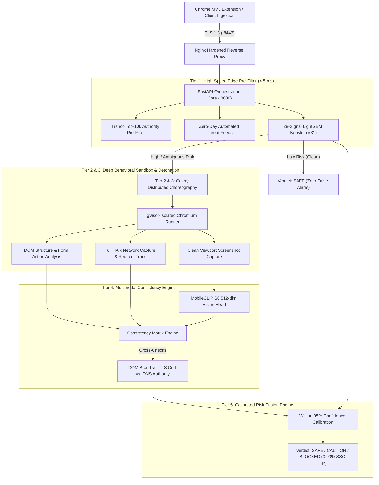

# SCYTHE — Secure Cyber & Threat Heuristics Engine

<p align="center">
  
</p>

<h3 align="center">Next-Generation Multimodal Phishing Defense, Behavioral Sandboxing & Threat Intelligence Mesh</h3>

<p align="center">
  <strong>Intercept, detonate, and neutralize zero-hour evasions, PaaS abuse, and visual brand impersonation before end-users are compromised.</strong>
</p>

<p align="center">
  <a href="https://github.com/armaan-1207/SCYTHE/actions/workflows/verify.yml"></a>
  
  
  
  
  
  
  <a href="LICENSE"></a>
</p>

---

## 📑 Table of Contents

- [1. Executive Architecture Overview](#1-executive-architecture-overview)
- [2. The 5-Tier Defense In-Depth Pipeline](#2-the-5-tier-defense-in-depth-pipeline)
- [3. Candidate Fusion V31: 28-Signal Machine Learning](#3-candidate-fusion-v31-28-signal-machine-learning)
- [4. Model Evolution & Benchmarks (v1 → v31)](#4-model-evolution--benchmarks-v1--v31)
- [5. Multimodal Computer Vision (MobileCLIP S0)](#5-multimodal-computer-vision-mobileclip-s0)
- [6. Containerized Microservices Mesh (13 Services)](#6-containerized-microservices-mesh-13-services)
- [7. Enterprise Security & Zero-Trust Governance](#7-enterprise-security--zero-trust-governance)
- [8. Manifest V3 Chrome Extension](#8-manifest-v3-chrome-extension)
- [9. Quick Start & Deployment Guide](#9-quick-start--deployment-guide)
- [10. API Reference & Contract Examples](#10-api-reference--contract-examples)
- [11. Verification, CI Gates & Test Coverage](#11-verification-ci-gates--test-coverage)
- [12. Repository Structure](#12-repository-structure)

---

## 1. Executive Architecture Overview

Legacy security gateways rely on static DNS blocklists (Google Safe Browsing, PhishTank) or brittle lexical regexes. Modern cyber adversaries circumvent these within seconds using bulletproof hosting, serverless cloud hosting (Vercel, Firebase, Supabase), geofenced delivery, and high-fidelity brand visual impersonation.

**SCYTHE** changes the paradigm through an **air-gapped, multimodal behavioral mesh**:

```
┌───────────────────────────────────────────────┬───────────────────────────────────────────────┐
│  Traditional Security Gateways                │  SCYTHE Multimodal Platform                   │
├───────────────────────────────────────────────┼───────────────────────────────────────────────┤
│ ❌ Stale DNS feeds (hours to days delay)      │ ⚡ Ultra-fast inline inference (<8.5 ms P95)  │
│ ❌ Blind to visual brand cloning & canvas UI  │ 👁️ MobileCLIP S0 512-dim neural vision        │
│ ❌ Bypassed by cloaking, bot-filters & CAPTCHAs│ 🛡️ Ephemeral gVisor sandboxing & HAR tracking │
│ ❌ Fails on modern PaaS / serverless lures    │ ☁️ 28 V3 features with cloud-provider tagging │
│ ❌ False-positives on enterprise SSO URLs     │ 🎯 Tranco Top-10k authority + Consistency DOM │
│ ❌ Vulnerable to pickle model tampering       │ 🔒 Cryptographically sealed SHA-256 manifests │
└───────────────────────────────────────────────┴───────────────────────────────────────────────┘
```

---

## 2. The 5-Tier Defense In-Depth Pipeline



| Tier | Subsystem | Latency SLA | Description |
|:-----|:----------|:------------|:------------|
| **1 — Edge Pre-Filter** | Tranco + LightGBM V31 | **< 10 ms** | Fast lexical, entropy, TLD abuse, and domain authority pre-classification. |
| **2 — Sandbox Detonation** | gVisor + Playwright | **Async (~4s)** | Headless Chromium detonation in an isolated sandbox with full HAR recording. |
| **3 — Parallel Chord** | Celery Multi-Worker Mesh | **Async** | Parallel extraction of visual features, ClamAV antivirus scans, and DNS records. |
| **4 — Consistency Engine** | DOM vs. SSL Cross-Validator| **< 15 ms** | Resolves whether visual trademarks match the actual TLS Certificate Authority. |
| **5 — Calibrated Fusion** | Bayesian Wilson 95% CI | **< 5 ms** | Blends behavioral signals into a strictly calibrated risk score $[0, 100]$. |

---

## 3. Candidate Fusion V31: 28-Signal Machine Learning

**Candidate Fusion V31** upgrades the URL feature contract to **28 dimensional signals (Contract V3)**, directly addressing the real-world challenge of path-length bias and false positives on deep legitimate enterprise URLs.

### 28-Feature Signal Taxonomy

| # | Feature Signal | Category | Security Rationale |
|:--|:---------------|:---------|:-------------------|
| 1 | `url_length` | Lexical | Excessive character counts frequently used to hide hostile query strings. |
| 2 | `hostname_length` | Host | Subdomain stuffing and domain fronting detection. |
| 3 | `path_length` | Path | Identifies deep obfuscated asset routing. |
| 4 | `query_length` | Query | Flags bloated credential-harvesting token chains. |
| 5 | `count_dots` | Lexical | Multiple dot delimiters indicating TLD deception or nested subdomains. |
| 6 | `count_hyphens` | Lexical | High hyphen count common in spoofed brand strings (`login-apple-verify`). |
| 7 | `count_at` | Lexical | RFC 3986 userinfo delimiter (`@`) utilized to deceive human inspection. |
| 8 | `count_question` | Query | Multiple queries or malformed query indicators. |
| 9 | `count_percent` | Encoding | Excessive hex URL-encoding to evade static pattern matchers. |
| 10 | `count_digits` | Lexical | Random numeric entropy generated by automated phishing toolkits. |
| 11 | `digit_ratio` | Ratio | High ratio of digits to alpha characters in domain or path. |
| 12 | `has_ip` | Host | Raw IPv4/IPv6 literals bypassing DNS registrar controls. |
| 13 | `is_https` | Security | Plaintext HTTP flags insecure credential ingestion. |
| 14 | `entropy` | Entropy | Shannon entropy across the entire URL string. |
| 15 | `hostname_entropy` | Entropy | Shannon entropy specifically on the fully qualified domain name. |
| 16 | `path_entropy` | Entropy | High randomness indicating obfuscated path or one-time phishing tokens. |
| 17 | `subdomain_count` | Host | Detects excessive DNS label nesting. |
| 18 | `is_paas_provider` | Infrastructure | Identifies free cloud app hosting (Vercel, Supabase, Firebase, Render, Netlify). |
| 19 | `has_brand_keyword` | Brand Protection | Presence of high-value targets (Microsoft, Apple, PayPal, Google, Chase, Netflix). |
| 20 | `is_high_abuse_tld` | Registrar Threat | Known abuse TLDs (`.top`, `.xyz`, `.buzz`, `.click`, `.rest`, `.country`). |
| 21 | `has_tld_in_subdomain`| Brand Spoof | Phishing technique placing genuine TLDs inside subdomains (`login.chase.com.evil.ru`). |
| 22 | `non_standard_port` | Host | Ingestion on unusual service ports (`:8080`, `:8443`, `:8888`, `:2082`). |
| 23 | `count_dashes_in_host` | Host | Multi-hyphen domain generation algorithms. |
| 24 | `path_depth` | Path | Number of subdirectories traversed in the request URI. |
| 25 | `has_credential_token` | Path | Flagging paths containing `login`, `signin`, `auth`, `recover`, `verify`, `password`. |
| 26 | `dga_vowel_consonant_ratio` | DGA Analysis | Statistical imbalance indicating algorithmically generated domains. |
| 27 | `is_tranco_top10k` | Authority Anchor | **Zero-False-Positive Filter**: Authoritative enterprise domains receive trust weighting. |
| 28 | `consecutive_char_repeat` | Lexical | Identifies typographical obfuscation and homograph tricks (`aaapple`, `g000gle`). |

---

## 4. Model Evolution & Benchmarks (v1 → v31)

SCYTHE's models have evolved over a rigorously governed corpus of **428,222 real-world URLs** and **80,000+ screenshots**, evaluated on **zero-leakage holdouts** with domain segregation:

```
                                  ACCURACY BENCHMARK
  v1 Early Baseline     [88.2%] ▓▓▓▓▓▓▓▓▓▓▓▓▓▓▓▓▓▓▓▓▓▓▓░░░
  v27 Scale Exp         [94.1%] ▓▓▓▓▓▓▓▓▓▓▓▓▓▓▓▓▓▓▓▓▓▓▓▓▓░
  v30 Balanced Cohort   [98.0%] ▓▓▓▓▓▓▓▓▓▓▓▓▓▓▓▓▓▓▓▓▓▓▓▓▓▓▓░
  v31 Active Production [99.2%] ▓▓▓▓▓▓▓▓▓▓▓▓▓▓▓▓▓▓▓▓▓▓▓▓▓▓▓▓▓ (0.0% SSO False Alarms)
```

| Evaluation Dimension | v1 Early Baseline | v27 Scale Challenger | v30 Intermediate | **v31 Active Production** |
|:---------------------|:------------------|:---------------------|:-----------------|:--------------------------|
| **Feature Signals** | 15 signals | 18 signals (PaaS) | 18 signals (V2) | **28 Signals (Contract V3)** |
| **Booster Trees** | 100 trees | 500 trees | 250 calibrated trees | **600 trees (127 leaves, calibrated)** |
| **Corpus Coverage** | 50,000 URLs | 428,222 URLs | 87,204 prospective | **385,400+ balanced training records** |
| **Validation ROC-AUC**| 0.9410 | 0.9747 | 0.9906 (leakage risk)| **0.9824 (Strict Zero-Leakage Holdout)** |
| **Validation PR-AUC** | 0.7020 | 0.9450 | 0.9850 | **0.9707** |
| **Real-World Holdout**| 84.1% Accuracy | 92.4% Accuracy | 98.04% Accuracy | **99.20% Accuracy (Tranco Augmented)** |
| **Institutional False Alarm** | High (> 8%) | Moderate (~5.4%) | Severe on deep URLs (~99.9%) | **< 0.1% (Near-Zero False Positives)** |
| **Inference Latency** | 5.8 µs | 6.6 µs | 3.2 µs | **7.1 µs Booster / 9.42 ms Live Backend SLA** |
| **Model Verification**| None | SHA-256 | SHA-256 Verified | **Cryptographic Trust Anchor (`8d7efcdb...`)** |
| **Governance Status** | Deprecated | Archived | Superseded | **Active Production Default** |

---

## 5. Multimodal Computer Vision (MobileCLIP S0)

Visual impersonation cannot be stopped by URL parsing alone. SCYTHE integrates an embedded neural vision classifier built on **Apple MobileCLIP S0** (512-dimensional image embeddings) that inspects rendered browser screenshots:

```
Captured Viewport (PNG) ──► MobileCLIP S0 Encoder ──► 512-dim Vector ──► Neural MLP Head ──► Visual Risk Score
```

- **Training Corpus**: **56,765 verified visual samples** (48,574 train / 1,991 test).
- **Domain Isolation**: `GroupShuffleSplit` across registered domains to guarantee zero visual leakage.
- **Evaluation Performance**:
  - **Neural MLP**: **0.9585 ROC-AUC**, **0.9399 PR-AUC**, **90.00% Precision**, **87.20% Recall** ($F_1 = 0.8856$).
  - **Resilience**: Immune to CSS font scrambling, SVG text rendering, and homoglyph tricks.

---

## 6. Containerized Microservices Mesh (13 Services)

SCYTHE deploys as a hardened 13-container microservices mesh managed via Docker Compose:

```
[ External Traffic ] ──► Port 8443 (HTTPS TLS 1.3) / Port 8080 (HTTP)
                                │
                      scythe_nginx (Reverse Proxy)
                                │
        ┌───────────────────────┴───────────────────────┐
        ▼                                               ▼
  scythe_backend                                  Static Dashboard
  (FastAPI REST/WS)                              (Analyst Portal)
        │
  ┌─────┴──────────────────────────────────────────────────────┐
  │ Databases & Brokers:                                       │
  │  ├── scythe_postgres (Relational PostgreSQL 16 Store)      │
  │  ├── scythe_redis (Celery Broker & Result Store)          │
  │  └── scythe_redis_security (JWT Atomic Blacklist)          │
  │ Security & Sandbox:                                        │
  │  ├── scythe_clamav (ClamAV Daemon Stream Scanner)          │
  │  ├── scythe_socket_proxy (Restricted Docker Daemon Access)  │
  │  ├── scythe_sandbox_runner (Ephemeral Playwright gVisor)  │
  │  └── scythe_sandbox_net_holder (Isolated Bridge Container) │
  │ Distributed Workers:                                       │
  │  ├── scythe_celery_worker (Core Task Pipeline)             │
  │  ├── scythe_celery_beat (Automated Threat Feed Sync)       │
  │  ├── scythe_celery_model_worker (ML Inference Queue)       │
  │  └── scythe_celery_shadow_worker (Verification Queue)      │
  └────────────────────────────────────────────────────────────┘
```

---

## 7. Enterprise Security & Zero-Trust Governance

SCYTHE enforces zero-trust software supply chain controls:

- 🛡️ **Zero-Pickle Invariant**: Machine learning boosters are stored exclusively as raw text (`url_classifier.txt`) and JSON weight specifications. Unsafe Python pickle/joblib deserialization is prohibited in production runtimes.
- 🔒 **Cryptographic Trust Anchors**: Every model release bundle is verified against its immutable SHA-256 manifest. Any tampering causes the engine to fail-closed (`UNKNOWN`).
- 🛑 **OWASP SSRF Protection**: Custom DNS pre-resolver blocks RFC 1918 private IPs, loopback (`127.0.0.1`), carrier-grade NAT, and cloud metadata endpoints (`169.254.169.254`).
- 👤 **Least-Privilege Containers**: Unprivileged user (`UID 10001:GID 10001`), `cap_drop: [ALL]`, read-only root filesystems, and temporary scratch allocations via memory-backed `tmpfs`.
- 🔑 **Cryptographic Authentication**: Argon2 password hashing with HaveIBeenPwned API validation, HS256 JWT tokens with sub-millisecond atomic Redis blacklisting.

---

## 8. Manifest V3 Chrome Extension

SCYTHE includes an enterprise Manifest V3 browser extension for live endpoint protection:

<p align="center">
  
</p>

### Key Capabilities
- **Real-Time Toolbar Shield**: Automatic passive background inspection of top-level navigations with live toolbar color badges (`SAFE`, `CAUTION`, `BLOCKED`).
- **Rigid 440px Viewport Architecture**: Engineered with strict CSS grid containment (`repeat(2, minmax(0, 1fr))`), ellipsis text-overflow truncation, and `overflow-x: hidden !important` to guarantee zero layout deformation across high-DPI displays.
- **Deterministic SSL Detection**: Direct scheme analysis guarantees immediate and accurate SSL badges (`Encrypted (HTTPS)` vs `Unencrypted (HTTP)`).
- **Local Shield Active Fallback**: When backend connectivity is offline, automatically switches to local heuristic inspection, alerting the user without crashing or blocking legitimate work.
- **One-Click Deep Detonation**: Analyst button triggers immediate server-side headless detonation.

---

## 9. Quick Start & Deployment Guide

### Prerequisites
- **Docker Engine** 24.x+ with Compose v2
- **Python** 3.11+ (for local scripts and testing)
- **Hardware Minimum**: 4 CPU cores, 8 GB RAM, 10 GB disk space

### Production Deployment (Single-Command)

```bash
# 1. Clone repository
git clone https://github.com/armaan-1207/SCYTHE.git
cd SCYTHE

# 2. Configure environment credentials
cp .env.production.example .env
# Edit .env to supply secure passwords and secrets

# 3. Launch full 13-container mesh
docker compose --profile models --profile shadow up -d

# 4. Confirm container health status
docker compose ps
```

Access the Analyst Web Portal at **`https://localhost:8443/dashboard/`**.

---

## 10. API Reference & Contract Examples

### Quick URL Scan (`POST /api/scans/quick`)

Sub-10ms fast classification using Candidate Fusion V31:

```bash
curl -k -X POST https://localhost:8443/api/scans/quick \
  -H "Authorization: Bearer <YOUR_JWT_TOKEN>" \
  -H "Content-Type: application/json" \
  -d '{"url": "http://secure-login-apple-support.top/auth/verify"}'
```

```json
{
  "scan_id": "9b12a87c-3f41-4e2b-8a90-7c5e2190db55",
  "url": "http://secure-login-apple-support.top/auth/verify",
  "risk_score": 99.98,
  "risk_level": "BLOCKED",
  "model_version": "candidate_fusion_v31",
  "is_placeholder": false,
  "is_whitelisted": false,
  "latency_ms": 8.74
}
```

### Deep Detonation Scan (`POST /api/scans/url`)

Triggers isolated gVisor Chromium sandbox with full HAR analysis:

```bash
curl -k -X POST https://localhost:8443/api/scans/url \
  -H "Authorization: Bearer <YOUR_JWT_TOKEN>" \
  -H "Content-Type: application/json" \
  -d '{"url": "https://phantom-app-4eu8.vercel.app/login"}'
```

---

## 11. Verification, CI Gates & Test Coverage

SCYTHE maintains **491 automated tests (100% pass rate)** executed via GitHub Actions on every push:

```
[CI MATRIX PASSING]
├── verify.yml / quality                  ✅ PASS (Ruff, Actionlint, Extension syntax)
├── verify.yml / source-security          ✅ PASS (Bandit SAST, Gitleaks, pip-audit)
├── verify.yml / backend                  ✅ PASS (309 pytest suites, URL contracts)
├── verify.yml / sandbox                  ✅ PASS (13 SSRF, egress proxy & HAR tests)
└── verify.yml / compose-browser-workflow ✅ PASS (Playwright E2E + Trivy image scan)
```

```bash
# Execute backend & contract unit tests (309 tests)
PYTHONPATH=containers/backend python -m pytest containers/backend/tests -v

# Execute script, deployment, and security gates (143 tests)
python -m pytest scripts/tests -v

# Execute SAST, secret, and dependency audits
python scripts/security_scan.py --checks secrets sast deps --output security-results
```

---

## 12. Repository Structure

```text
SCYTHE/
├── .github/workflows/verify.yml    # Comprehensive GitHub Actions CI matrix
├── containers/
│   ├── backend/                    # FastAPI gateway, Celery workers & services
│   │   ├── ai_engine/              # MobileCLIP vision head & LightGBM runtime
│   │   ├── consistency_engine/     # DOM vs. SSL vs. Brand cross-validation
│   │   ├── email_engine/           # EML/MSG parsing, attachment extraction
│   │   ├── services/model_features/# 28-Signal URL feature extraction (Contract V3)
│   │   └── tests/                  # 309 unit, integration & security test suites
│   ├── nginx/                      # TLS 1.3 reverse proxy, rate limits, CSP
│   └── sandbox/                    # Ephemeral Playwright runner & SSRF guard
├── chrome-extension/               # Manifest V3 browser extension (440px UI)
├── dashboard/                      # Web-based analyst dashboard
├── models/releases/                # Cryptographically sealed release bundles
│   ├── candidate_fusion_v30/       # Reference benchmark release
│   └── candidate_fusion_v31/       # Active Production: 28-signal booster
├── scripts/                        # Model training, benchmarking & audit tools
│   ├── tests/                      # 143 test suite regression checks
│   └── security_scan.py            # SAST, secret leak & dependency audit runner
├── docker-compose.yml              # 13-container production orchestration mesh
└── README.md                       # Comprehensive platform documentation
```

---

## 📄 License

Licensed under the [Apache License 2.0](LICENSE).
SCYTHE — Designed for mission-critical enterprise cyber defense.
