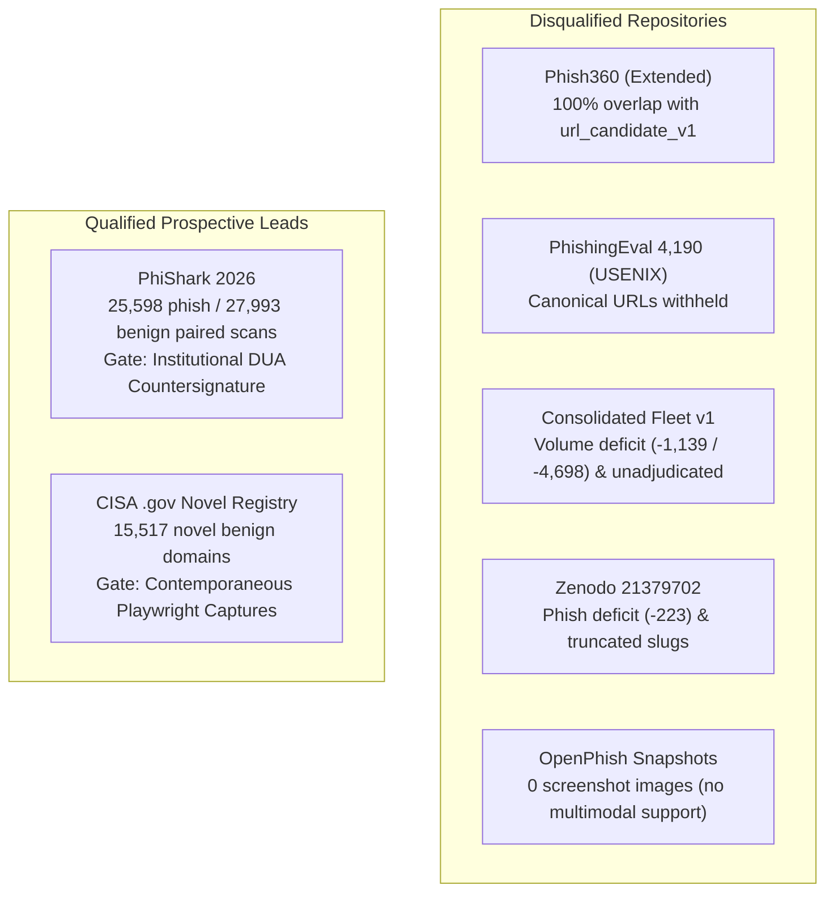
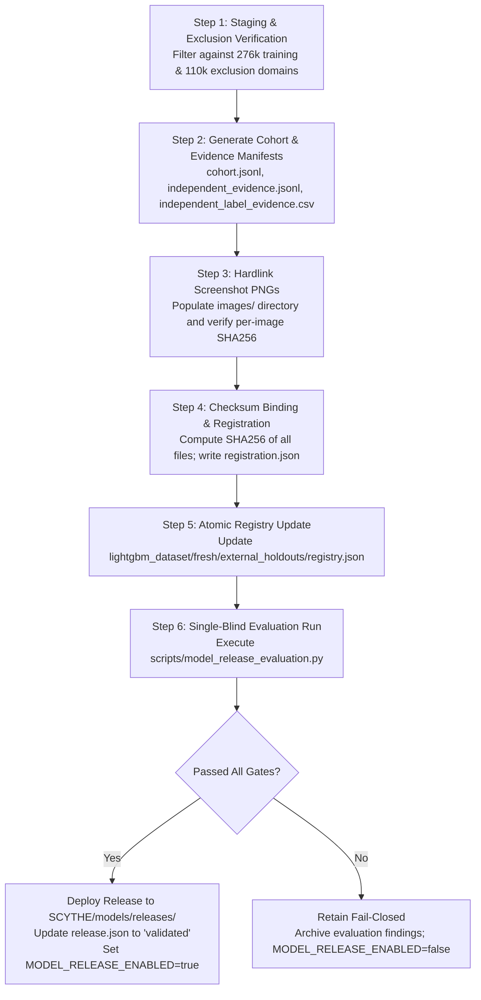

# SCYTHE Independent Release Qualification Checklist
**Document ID**: SCYTHE-CHK-20261025-01  
**Specialist Role**: Independent Qualification Specialist  
**Target Release**: SCYTHE Multimodal Fusion Model v2 (`v21_multimodal_fusion` / `scythe_fusion_v2`)  
**Effective Date**: October 25, 2026  
**Current Operational Status**: **RELEASE DISAPPROVED — SYSTEM FAIL-CLOSED (`MODEL_RELEASE_ENABLED=false`)**  

---

## 1. Executive Status & Deficit Accounting

The SCYTHE Model Governance Charter mandates that any production model release must be qualified on an untouched, domain-disjoint external holdout of verified independent historical labels before production enablement.

### Current Holdout Deficit Summary

| Cohort Class | Approved Policy Floor | Genuinely Qualified in Local Workspace | Current Absolute Deficit |
| :--- | :--- | :--- | :--- |
| **Phishing Domain Groups** | **$\ge 2,000$** unique groups | **0** | **-2,000 domain groups** |
| **Benign Domain Groups** | **$\ge 5,000$** unique groups | **0** | **-5,000 domain groups** |
| **Total Cohort Requirement** | **$\ge 7,000$** unique groups | **0** | **-7,000 domain groups** |

---

## 2. Source-by-Source Audit: Available vs. Disqualified



### Detailed Audited Repositories

#### Disqualified Phishing Sources
1. **Phish360 (`mobileclip-dataset/extended`)**:
   - *Status*: **DISQUALIFIED**.
   - *Audit Finding*: 4,206 phishing records examined. Cross-referencing against frozen candidate-time exclusions (`lightgbm_dataset/exclusions/url_candidate_v1`, 110,185 domains) revealed **100% overlap (0 clean domains)**.
   - *Policy Violation*: Re-evaluating frozen development exclusions as an untouched holdout is strictly prohibited.
2. **PhishingEval 4,190 (`dataset-acquisition/phishingeval_phishing4190_dev_v1`)**:
   - *Status*: **DISQUALIFIED**.
   - *Audit Finding*: 4,190 records (3,097 extracted pairs). Manifest confirms `url_available: false`. The USENIX Security 2025 publication terms state that URLs were withheld/reduced to domains for ethical sharing.
   - *Policy Violation*: Fabricating synthetic URLs (`https://{domain}/`) violates data provenance. Contemporaneous canonical URLs are required.
3. **Consolidated Fleet v1 Phishing (`lightgbm_dataset/consolidated_fleet_v1`)**:
   - *Status*: **DISQUALIFIED**.
   - *Audit Finding*: Only 861 clean, non-overlapping phishing domains with images exist (Deficit of -1,139 vs 2,000 floor). Sourced as unadjudicated automated live feeds (`source: "live_feed"`).
4. **Zenodo 21379702 Phishing (`dataset-acquisition/zenodo21379702_v1`)**:
   - *Status*: **DISQUALIFIED**.
   - *Audit Finding*: 1,777 phishing images (Deficit of -223 vs 2,000 floor). Filenames contain truncated slugs (`q-r.to_bfInU9`) rather than complete canonical URLs; commercial redistribution rights unverified.
5. **OpenPhish Fresh Snapshots (`lightgbm_dataset/fresh/snapshots`)**:
   - *Status*: **DISQUALIFIED**.
   - *Audit Finding*: 3,258 URLs across 33 snapshots contain 0 screenshot images, failing the `deep_url` multimodal evaluation contract.
6. **Phishpedia Pilot (`dataset-acquisition/phishpedia_v1`)**:
   - *Status*: **DISQUALIFIED**.
   - *Audit Finding*: Contains only 16 pilot phishing pairs (Deficit of -1,984 vs 2,000 floor).

#### Disqualified Benign Sources
1. **Phish360 Benign (`mobileclip-dataset/extended`)**:
   - *Status*: **DISQUALIFIED**.
   - *Audit Finding*: 6,330 records examined; 6,328 overlap with candidate exclusions (only 2 clean domains).
2. **Tranco Popularity Feeds**:
   - *Status*: **DISQUALIFIED AS GROUND TRUTH**.
   - *Audit Finding*: Popularity rank alone does not prove that a specific webpage is benign or free from compromise.
3. **Consolidated Fleet v1 Benign (`lightgbm_dataset/consolidated_fleet_v1`)**:
   - *Status*: **DISQUALIFIED**.
   - *Audit Finding*: Only 302 clean, non-overlapping benign domains with valid screenshots exist (Deficit of -4,698 vs 5,000 floor). Unadjudicated live feeds.

#### Prospective Leads for Future Holdout Acquisition
1. **PhiShark 2026 Threat Corpus (Phishing & Multi-Class Target)**:
   - *Status*: **ACTIONABLE PENDING HUMAN DUA COUNTERSIGNATURE**.
   - *Inventory*: 25,598 phishing and 27,993 benign paired scan records collected April–July 2026 with full technical evidence (screenshots, DOM, headers, DNS).
   - *Execution Requirement*: Submit finalized application package (`dataset-acquisition/phishark_2026_access_request_FINAL.md`) with authorized institutional signature.
2. **CISA .gov Official Registry (Benign Target)**:
   - *Status*: **ACTIONABLE PENDING SANDBOX CAPTURES**.
   - *Inventory*: 15,517 novel government domains with verified documented owner evidence.
   - *Execution Requirement*: Execute automated passive Playwright container captures per protocol (`dataset-acquisition/cisa_dotgov_capture_protocol.md`) to acquire $\ge 5,000$ active 200 OK captures.

---

## 3. Required Evidence Bundle Schema

Every release holdout bundle must be registered under `scythe_release_registration_v2` in `lightgbm_dataset/fresh/external_holdouts/<RUN_ID>/` and must contain the following cryptographic bindings:

| Required File | Format | Validation / Verification Rule |
| :--- | :--- | :--- |
| **`registration.json`** | JSON | Schema `scythe_release_registration_v2`, status `untouched_external_holdout`, operator attestation `true`. |
| **`cohort.jsonl`** | JSON Lines | $\ge 2,000$ phishing, $\ge 5,000$ benign. Unique `sample_id`, authentic `canonical_url`, matching `registrable_domain`, bound `image` dict. |
| **`independent_evidence.jsonl`** | JSON Lines | Exact 1:1 match with `cohort.jsonl` IDs. `independent: true`, `basis` $\in$ {`historical_publisher_adjudication`, `documented_site_owner_control`, `independent_historical_analysis`}, bound `evidence` dict. |
| **`independent_label_evidence.csv`** | CSV | Tabular evidence manifest required by `model_release_readiness.py`. SHA256 must match `registration.json["independent_evidence_sha256"]`. |
| **`exclusions.json`** | JSON | Full list of 276,033 training domains, 110,185 exclusion domains, and bound `source_manifests.json`. |
| **`models_by_path.json`** | JSON | Exact artifact paths and SHA-256 bindings for `quick_url` (`quick_classifier.txt`) and `deep_url` (`deep_classifier.txt`). |
| **`approved_policy.json`** | JSON | Bound copy of `SCYTHE/models/releases/approved_policy.json` matching recorded hash. |
| **`thresholds.json`** | JSON | Bound decision thresholds (`quick_url`: 0.85, `deep_url`: 0.50). |
| **`feature_contract.json`** | JSON | Bound feature contract specification (`scythe_fusion_v2`). |
| **`protocol.json`** | JSON | Bound copy of frozen release evaluation protocol. |
| **`source_code.tar.gz`** | Tar Gzip | Bound archive containing `score_release_candidate.py` and evaluation scripts. |
| **`images/`** | Directory | Physical, uncorrupted PNG screenshots corresponding to every sample in `cohort.jsonl`. |

---

## 4. Step-by-Step Procedure to Register a New Untouched Holdout

When prospective data arrives, follow this strict, linear procedure:



### Execution Details:
1. **Preflight Exclusion Verification**:
   Execute preflight domain check ensuring zero candidate domains overlap with any training split or candidate exclusion:
   ```powershell
   python -c "assert len(set(candidate_domains) & (training_domains | exclusion_domains)) == 0"
   ```
2. **Manifest Generation**:
   Generate `cohort.jsonl` ($\ge 2,000$ phishing, $\ge 5,000$ benign) and matching `independent_evidence.jsonl`. Export `independent_label_evidence.csv` and record its SHA-256 hash.
3. **Image Population**:
   Copy or hardlink (`os.link`) screenshot PNGs to `images/`. Compute and bind each image's SHA-256 into `cohort.jsonl`.
4. **Compile Bindings & Registration**:
   Write `registration.json` with schema `scythe_release_registration_v2`, status `untouched_external_holdout`, and bind all 9 required reference files.
5. **Update External Holdouts Registry**:
   Add the new run ID to `lightgbm_dataset/fresh/external_holdouts/registry.json` with `registration_sha256` and status `untouched_external_holdout`.
6. **Execute Single-Blind Release Evaluation**:
   Run the evaluation script once:
   ```powershell
   python SCYTHE/scripts/model_release_evaluation.py `
       --registration lightgbm_dataset/fresh/external_holdouts/<RUN_ID>/registration.json `
       --predictions lightgbm_dataset/fresh/external_holdouts/<RUN_ID>/predictions/predictions.json `
       --output-dir SCYTHE/models/releases/ `
       --dataset-deps lightgbm_dataset/_deps
   ```
7. **Readiness Audit & Fail-Closed Gate**:
   Execute `python SCYTHE/scripts/model_release_readiness.py`. Only if `production_ready: true` and blocker count is 0 may the release manifest be updated to `"status": "validated"` and `MODEL_RELEASE_ENABLED=true` activated.
