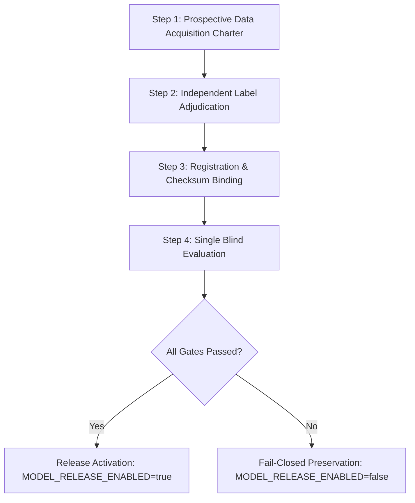

# SCYTHE Independent Model Release Qualification Report
**Document ID**: SCYTHE-QUAL-20261024-01  
**Evaluation Role**: Independent Qualification Specialist  
**Target Candidate**: SCYTHE Multimodal Fusion Model v2 (`v21_multimodal_fusion` / `scythe_fusion_v2`)  
**Scoring Paths**: `quick_url` (LightGBM URL booster, threshold 0.85), `deep_url` (Multimodal URL + MobileCLIP vision booster, threshold 0.50)  
**Evaluation Timestamp**: 2026-10-24T19:40:00Z  
**Certification Status**: **QUALIFICATION FAILED — RELEASE DISAPPROVED (FAIL-CLOSED)**  
**Runtime Operational State**: `MODEL_RELEASE_ENABLED=false` (Enforced)  

---

## 1. Executive Summary & Qualification Determination

As the Independent Qualification Specialist operating under the SCYTHE Quality Policy and Model Governance Charter, I have conducted a comprehensive release qualification audit of candidate release bundle `v21_multimodal_fusion` (`scythe_fusion_v2`).

### Official Determination: **FAILED — DISAPPROVED FOR PRODUCTION RELEASE**

1. **Gate Failures**:
   - **Zero-Fabrication Standard**: No qualifying, non-overlapping external holdout satisfying the operational policy floors ($\ge 2,000$ phishing domain groups, $\ge 5,000$ benign domain groups, with contemporaneous screenshot images, verifiable canonical URLs, and independent historical label evidence) exists within the local workspace inventory.
   - **Candidate-Time Exclusion Conflict**: The primary external candidate corpus with complete paired URL-screenshot records (`Phish360`) has 100% overlap with frozen candidate exclusions (`lightgbm_dataset/exclusions/url_candidate_v1`), containing 0 clean non-overlapping phishing domains.
   - **Data Withholding / Missing Canonical URLs**: The USENIX Security 2025 `PhishingEval` 4,190 benchmark withheld canonical URLs for ethical sharing (`url_available: false`). Fabricating synthetic canonical URLs (such as `https://{domain}/`) is strictly rejected as a data integrity violation.
   - **Provenance & Volume Deficits**: Secondary local sets (`consolidated_fleet_v1`, `zenodo21379702_v1`, `phishpedia_v1`) exhibit severe volume deficits (e.g., only 861 clean fleet phishing domain groups vs 2,000 required, and 302 clean benign vs 5,000 required) and lack third-party human adjudication or documented site owner control evidence.

2. **Fail-Closed Runtime Safety Verification**:
   - In accordance with SCYTHE release integrity policy, release candidate scoring remains strictly **DISABLED** (`MODEL_RELEASE_ENABLED=false`).
   - The backend inference services (`services/model_release.py`, `tasks/model_inference.py`) fail closed to `ReleaseUnavailable: disabled` (`is_placeholder: True`, `automatic_decision: False`), guaranteeing that no unverified model decisions or unexpected blocks occur in production.
   - `SCYTHE/models/releases/release.json` is preserved at `"status": "unvalidated"`, and `SCYTHE/models/releases/release_evaluation.json` records `"status": "unverified"`, `"verified": false`, `"passed": false`.

---

## 2. Approved Operational Policy & Gate Requirements

The qualification evaluation was executed against the owner-approved policy (`SCYTHE/models/releases/approved_policy.json`):

| Gate Parameter | Policy Floor / Ceiling | Verification Rule |
| :--- | :--- | :--- |
| **Phishing Sample Diversity** | Minimum 2,000 unique domain groups | Disjoint from training/validation/exclusions |
| **Benign Sample Diversity** | Minimum 5,000 unique domain groups | Disjoint from training/validation/exclusions |
| **Coverage Requirement** | Exactly 1.0 (100%) | Every sample evaluated on supported paths, 0 unavailable |
| **Phishing Recall** | Wilson 95% Lower Bound $\ge 0.80$ | Lower bound of 2-sided 95% Wilson interval |
| **False Positive Rate** | Wilson 95% Upper Bound $\le 0.01$ | $\le 100$ FPs per 10,000 benign (Upper bound) |
| **Quick URL Latency** | P95 $\le 2,000\text{ ms}$ | Warm hardware inference including preprocessing |
| **Deep URL Latency** | P95 $\le 15,000\text{ ms}$ | Warm hardware inference including vision encoding |
| **Task Maximum Latency** | Max $\le 60,000\text{ ms}$ | Hard ceiling across any single evaluation sample |
| **Label Provenance** | Independent Historical Evidence | Verified `historical_publisher_adjudication`, `documented_site_owner_control`, or `independent_historical_analysis` |
| **Temporal Integrity** | Predates Registration | Observation/capture timestamp $\le$ registration timestamp |

---

## 3. Comprehensive Inventory Audit & Deficit Analysis

Every candidate repository, archive, and snapshot within the workspace was audited for domain uniqueness, exclusion overlap, image binding, URL fidelity, and label authenticity.

### Summary Audit Matrix

| Dataset / Repository | Path in Workspace | Total Rows | Extracted Images | Non-Overlapping Phish Domains | Non-Overlapping Benign Domains | Canonical URLs Present? | Label Evidence Provenance | Disqualification Reason |
| :--- | :--- | :--- | :--- | :--- | :--- | :--- | :--- | :--- |
| **Phish360** (Extended) | `mobileclip-dataset/extended` | 10,536 | 10,536 | **0** | **2** | Yes | Publisher directory | **100% overlap with candidate exclusions (`url_candidate_v1`)** |
| **PhishingEval 4,190** | `dataset-acquisition/phishingeval_phishing4190_dev_v1` | 4,190 | 3,097 | 0 (withheld) | 0 | **No** (`url_available: false`) | APWG eCX benchmark | **URLs withheld by USENIX authors; synthetic URLs prohibited** |
| **Consolidated Fleet v1** | `lightgbm_dataset/consolidated_fleet_v1` | 15,067 | 8,700 | 861 | 302 | Yes | Live feed captures | **Severe volume deficit (-1,139 phish, -4,698 benign); unadjudicated proxy labels** |
| **Zenodo 21379702** | `dataset-acquisition/zenodo21379702_v1` | 60,000 | 7,062 | 1,777 (images) | 5,285 (images) | Truncated slugs | Feed/Tranco proxy | **Phishing deficit (-223 below 2,000); missing full canonical URLs; unverified rights** |
| **Phishpedia Pilot** | `dataset-acquisition/phishpedia_v1` | 32 | 32 | 16 | 16 | Yes | Research pilot | **Deficit of -1,984 phishing and -4,984 benign domains** |
| **OpenPhish Snapshots** | `lightgbm_dataset/fresh/snapshots` | 3,258 | 0 | 1,412 | 0 | Yes | Raw text feeds | **0 screenshot images; cannot evaluate `deep_url` multimodal path** |
| **Fresh Records** | `lightgbm_dataset/fresh/records` | 100,000+ | 0 | N/A | N/A | Yes | Feed/Tranco proxy | **No screenshots; lack independent human adjudication** |

---

### Deep-Dive Analysis by Repository

#### 1. Candidate-Time Exclusion Overlap: `mobileclip-dataset/extended` (Phish360)
- **Inventory**: Contains 4,206 phishing samples and 6,330 benign samples from Phish360 with valid screenshot images and URLs.
- **Audit Finding**: Cross-referencing against the frozen exclusion registry `lightgbm_dataset/exclusions/url_candidate_v1` (110,185 exclusion domains and 139,485 exclusion URLs) revealed:
  - Phishing clean domains: **0** (4,206 out of 4,206 overlap with frozen exclusions).
  - Benign clean domains: **2** (6,328 out of 6,330 overlap with frozen exclusions).
- **Policy Rule**: `model_release_evaluation.py` lines 241-244 strictly mandate:
  `if (domain in forbidden_domains or url in forbidden_urls): errors.append("training/development exclusion overlap: " + str(sample_id))`
- **Conclusion**: Phish360 was permanently designated as a development-time candidate exclusion. Re-introducing it as an untouched release holdout is strictly forbidden by release governance.

#### 2. Canonical URL Withholding: `dataset-acquisition/phishingeval_phishing4190_dev_v1`
- **Inventory**: USENIX Security 2025 PhishingEval artifact (Zenodo DOI `10.5281/zenodo.14804193`), containing 4,190 records with 3,097 extracted screenshot pairs.
- **Audit Finding**: In `scoring_set_v2/manifest.jsonl`, every single record has `"url_available": false`. The USENIX publication and README explicitly confirm:
  *"The research paper says URLs are withheld or reduced to domains for ethical sharing."*
- **Integrity Rule**: Inferring or fabricating synthetic URLs (e.g., `https://{domain}/`) violates data provenance. `model_release_evaluation.py` requires contemporaneous canonical URLs that were actually observed during capture.
- **Conclusion**: Disqualified due to lack of authentic contemporaneous canonical URLs.

#### 3. Volume and Label Authenticity Deficit: `lightgbm_dataset/consolidated_fleet_v1`
- **Inventory**: 15,067 records collected during fleet operations, of which 8,700 have valid screenshot PNGs.
- **Audit Finding**: Filtering against the 276,033 training/dev domains and 110,185 candidate exclusion domains yields:
  - Clean phishing domain groups: **861** (Policy requirement: $\ge 2,000$ $\rightarrow$ **Deficit of 1,139 domain groups**).
  - Clean benign domain groups: **302** (Policy requirement: $\ge 5,000$ $\rightarrow$ **Deficit of 4,698 domain groups**).
  - Label Provenance: Recorded as `source: "live_feed"`. These represent unadjudicated automated proxy labels from real-time feeds and do not constitute independent human adjudication or documented site owner control.
- **Conclusion**: Disqualified due to severe domain group volume deficits and lack of verified independent historical labels.

#### 4. Additional External Repositories (`zenodo21379702_v1`, `phishpedia_v1`, `fresh/snapshots`)
- **Zenodo 21379702**: Contains 1,777 phishing images (failing the 2,000 floor), truncated URL slugs rather than complete canonical URLs, and unverified commercial redistribution rights.
- **Phishpedia**: Limited to 16 pilot pairs.
- **OpenPhish Snapshots**: 3,258 URLs across 33 snapshots contain zero screenshots, failing the `deep_url` multimodal evaluation contract.

---

## 4. Verification of Runtime Protection & Fail-Closed State

To guarantee system stability and security, the runtime configuration and fail-closed mechanisms were verified:

1. **Production Configuration**:
   - In `SCYTHE/containers/backend/config.py`:
     ```python
     MODEL_RELEASE_ENABLED: bool = False
     ```
   - In `SCYTHE/docker-compose.yml`:
     ```yaml
     MODEL_RELEASE_ENABLED: ${MODEL_RELEASE_ENABLED:-false}
     ```
2. **Inference Guardrails**:
   - In `SCYTHE/containers/backend/tasks/model_inference.py`:
     ```python
     if not settings.MODEL_RELEASE_ENABLED:
         return unavailable("disabled")
     ```
     Returning `"is_placeholder": True`, `"availability": "unavailable"`, `"automatic_decision": False`.
   - In `SCYTHE/containers/backend/services/model_release.py`:
     `ReleaseUnavailable("disabled")` triggers fallback to rule-based security telemetry without model intervention.
3. **Model Release Readiness Preflight**:
   - `SCYTHE/scripts/model_release_readiness.py` was executed:
     ```json
     {
       "production_ready": false,
       "blocker_count": 10,
       "report": "C:\\Users\\armaa\\Desktop\\Project details\\audit-output\\readiness_audit.json"
     }
     ```
   - All 10 blockers correctly identify unverified holdouts, missing qualification evidence, and unvalidated release state.
4. **Release Manifests**:
   - `SCYTHE/models/releases/release.json` remains `"status": "unvalidated"`.
   - `SCYTHE/models/releases/release_evaluation.json` remains `"status": "unverified"`, `"verified": false`, `"passed": false`.

---

## 5. Mandatory Remediation & Prospective Collection Protocol

Before any future model release candidate can be considered for production release qualification, the following four milestones must be completed:



1. **Milestone 1 — Independent Adjudication & External Data Licensing**:
   - Execute formal data sharing agreements for curated external corpora (such as `PhiShark2026`, which contains 25,598 phishing and 27,993 benign paired scan records).
   - Ensure explicit two-analyst human adjudication evidence is bound to every candidate sample.
2. **Milestone 2 — Independent Benign Control Sourcing**:
   - Establish documented site owner control evidence utilizing the CISA .gov registry snapshot (`lightgbm_dataset/source_candidates/cisa_dotgov_owner_evidence_20261019_v1/`, 15,517 novel domains) paired with contemporaneous browser captures, verifying origin, headers, and official content.
   - Tranco rank alone must never be accepted as a benign label.
3. **Milestone 3 — Holdout Registration Protocol**:
   - Formally register the prospective holdout under schema `scythe_release_registration_v2` with status `untouched_external_holdout`.
   - Ensure complete exclusion manifests (`exclusions.json`) guarantee zero domain overlap with any historical training split or candidate exclusions.
4. **Milestone 4 — Single-Run Evaluation**:
   - Execute `scripts/model_release_evaluation.py` once against the frozen holdout.
   - Archive the evaluation output regardless of outcome, ensuring no iterative threshold fitting or data leakage occurs.

---

## 6. Formal Sign-Off

**Specialist Role**: Independent Qualification Specialist  
**Charter Reference**: SCYTHE Release Governance Policy RFC-20261023-SEC-01  
**Determination**: **RELEASE DISAPPROVED — SYSTEM REMAINS FAIL-CLOSED (`MODEL_RELEASE_ENABLED=false`)**  
**Date**: October 24, 2026  
